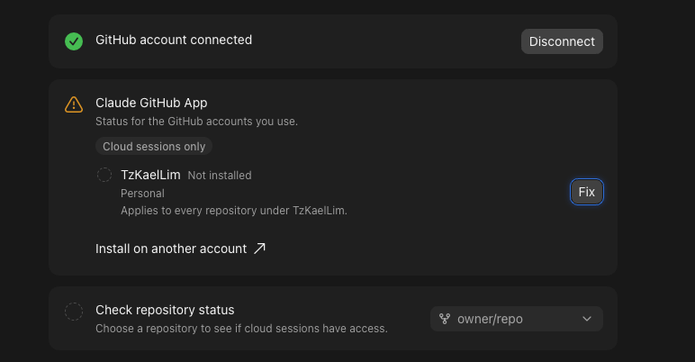
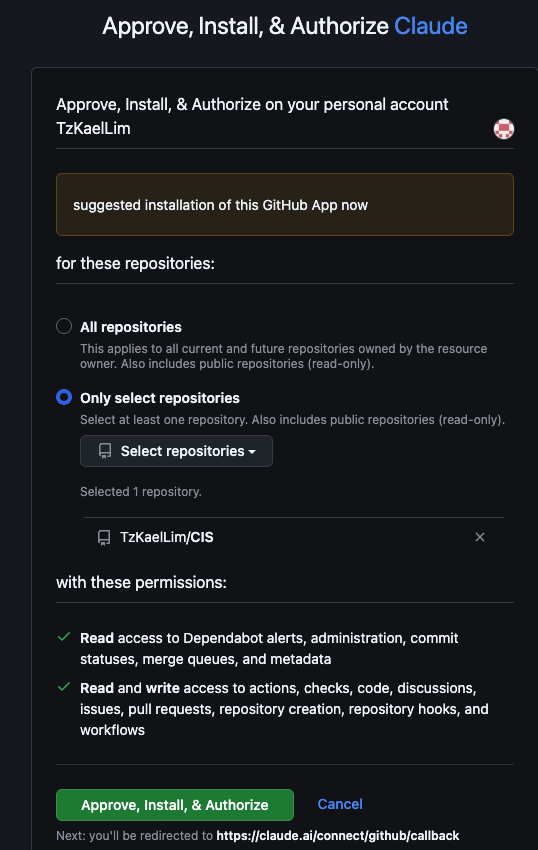

**先講結論**：安裝 Claude Desktop、登入，到 **Customize** → **Plugins** 搜尋 `github`，按 **Connect**，就完成了。不需要打指令，也不需要自己建立密碼或通行權杖。

這一頁寫給美編（設計）、致遠（廠商）和工程。看不懂的詞可以查[用詞](/docs/glossary/)；整個修改流程見[如何參與修改](/docs/contributing/)。

## 開始之前

- 你有 GitHub 帳號，而且已經被加進這個 repository。還沒有的話，請工程把你加進去。
- 你有可以登入 Claude 的帳號。沒有的話，請問工程。

## 四個步驟

### 1. 安裝 Claude Desktop

到 [Claude Desktop 的下載頁](https://claude.com/download)，下載 Claude Desktop（Mac 和 Windows 都有），照一般安裝程式的方式裝好。

### 2. 登入

打開 Claude Desktop，用你的 Claude 帳號登入。

### 3. 打開 Customize，找到 GitHub

1. 在左邊的側欄按 **Customize**。
2. 上方的分頁選 **Plugins**。
3. 在右邊的搜尋框輸入 `github`。
4. 清單裡會出現 **GitHub Integration**。

### 4. 按 Connect

1. 按 **GitHub Integration** 右邊的 **Connect**。
2. 照畫面的指示，用**你自己的** GitHub 帳號登入並同意授權。
3. 回到 Claude Desktop。**GitHub Integration** 的右邊顯示 **Connected**，點進去會看到下面的畫面，第一行是 **GitHub account connected**，就表示你的帳號連上了。

每個人只要做一次。換了電腦，重新登入 Claude 之後再確認一次是不是 **Connected**。

## 把 repository 開放給 Claude

上面那個畫面的第二塊 **Claude GitHub App**，管的是 Claude 能不能使用某一個 repository。畫面上標著 **Cloud sessions only**，表示它是給在雲端執行的工作用的。

**這一步只有 repository 的擁有者要做，做一次就好。** 其他人不用做，直接看下面的「其他人怎麼確認」。

1. 在 **Claude GitHub App** 那一塊，帳號旁邊寫著 **Not installed** 時，按右邊的 **Fix**。
2. 瀏覽器會打開 GitHub 的 **Approve, Install, & Authorize Claude** 頁面。
3. 在 **for these repositories** 選 **Only select repositories**，不要選 All repositories。
4. 按 **Select repositories**，選 `TzKaelLim/CIS`。下面會顯示 **Selected 1 repository**。
5. 按最下面綠色的 **Approve, Install, & Authorize**。

**其他人怎麼確認**：在第三塊 **Check repository status** 的選單選 `TzKaelLim/CIS`，就能看到 Claude 能不能使用它。顯示不能使用時，請工程確認。你自己的帳號旁邊寫 **Not installed** 沒有關係，因為這個 repository 不在你的帳號底下。

## 連接之後可以做什麼

在 Claude Desktop 上方切到 Code（`</>` 圖示），選 UIKit 的資料夾，用平常說話的方式說：

- 「幫我把這次的修改開成修改申請。」
- 「我的修改申請現在是什麼狀態？」
- 「PR #12 的核可人留了什麼意見？一條一條告訴我。」
- 「幫我回覆 PR #12 的第一則留言：按鈕的顏色已經改回來了。」

Claude 開修改申請之前，仍然會先跑檢查、開預覽、等你明確說可以，這些步驟不會因為連接了 GitHub 而省略。

這個連接**不做**下面三件事：

- 不合併修改申請。合併由有權限的人來做。
- 不替任何人核可修改申請。
- 不直接在 GitHub 上改檔案。修改一律在你電腦上的 UIKit 資料夾裡做，因為檢查和預覽都在那裡跑。

## 常見問題

**搜尋不到 GitHub Integration。** 先確認搜尋框裡打的是 `github`，分頁選的是 **Plugins**。還是沒有的話，可能是你的 Claude 帳號所屬的團隊還沒有開放這個連接，請問工程。

**Claude 說沒有權限，或找不到這個 repository。** 有三個可能：你還沒有被加進 repository；授權時登入的不是你平常用的 GitHub 帳號；或這個 repository 還沒有開放給 Claude（見上面的「把 repository 開放給 Claude」）。三種情況都請工程確認。

**想中斷連接。** 回到 **Customize** → **Plugins**，點 **GitHub Integration**，按 **GitHub account connected** 右邊的 **Disconnect**。之後要用，再做一次步驟 4。

**畫面上出現「Merge when ready」，可以按嗎？** 不要按。合併要等負責的角色核可之後，由有權限的人來做。

**為什麼不讓 Claude 直接在 GitHub 上改檔案？** 直接改會跳過在你電腦上跑的檢查和預覽，而這些檢查是目前合併前唯一的關卡。所以修改一律在你電腦上的資料夾裡做，確認之後再送出。
